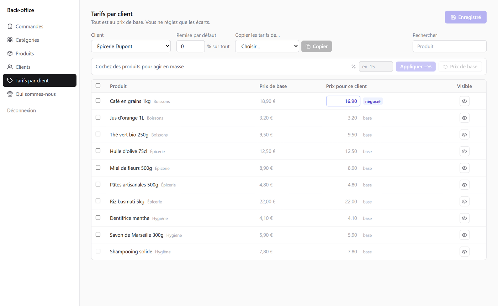
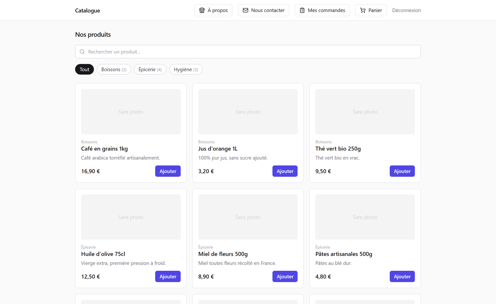

# B2B Catalogue

[](https://github.com/mdpinto111/b2b-catalogue/actions/workflows/ci.yml)


A private wholesale catalogue with **per-customer pricing**. Each business customer
signs in, sees only the products they are allowed to buy at *their* negotiated prices,
and places an order. There is no online payment. The order is stored and confirmed by
email to both the shop owner and the customer.

The interface is in French (built for a French wholesaler). The code and documentation
are in English.



| Customer catalogue | Back office |
|---|---|
|  | Orders with status tracking and Excel export, categories, products with images, customers, per-customer price grid, editable "About" page |

## Stack

**Next.js 15** (App Router, TypeScript) · **React 19** · **PostgreSQL** · **Prisma** ·
JWT sessions in httpOnly cookies (`jose`) · `bcrypt` · Tailwind CSS · Vitest ·
Docker · Caddy

## The pricing model

The interesting part of the project is how prices are stored. **Only deviations are stored.**
A new customer immediately sees the full catalogue at base price, with nothing to configure.
A row in `ClientProductPricing` exists only for an *exception*: a negotiated price and/or a
hidden product.

The price a customer pays is resolved server-side (`src/lib/pricing.ts`):

1. the **negotiated price** for that product, if there is one;
2. otherwise the customer's **global discount** (%) applied to the base price;
3. otherwise the **base price**.

So when the base price of a product changes, every customer without a negotiated price
follows it automatically.

The back-office grid is built around this model. Base prices are shown in grey and
negotiated prices in blue. You can bulk-select products and apply a percentage, copy one
customer's prices to another, and hide individual products.

## Security and correctness

- **Prices are never trusted from the browser.** Checkout receives product IDs and
  quantities only, and every price is recomputed from the database.
- **Order lines snapshot** the title and unit price, so order history stays accurate when
  the catalogue changes.
- **Money is stored as integer cents**, never as floats.
- **Order and lines are written in one transaction.** Emails are sent *after* the commit,
  so an email failure never loses an order.
- **Defence in depth on authorisation.** The middleware protects pages, and every API
  route checks the session role again (`requireClient` / `requireAdmin`).
- **Sessions fail closed.** The session secret is mandatory in production (at least
  32 characters), and cookies are `httpOnly`, `secure` and `sameSite=lax`.
- **Login endpoints are rate-limited**, and order size and quantities are capped.
- **User input is HTML-escaped** before it is rendered into emails.
- **Security headers** are set (`X-Frame-Options`, `nosniff`, `Referrer-Policy`, …),
  and the container runs as a non-root user.
- **CI** runs type checking, unit tests, a production build, `npm audit` on runtime
  dependencies and a Docker build.

## Quick start

With Docker, which starts PostgreSQL and the app and loads demo data:

```bash
docker compose -f docker-compose.local.yml up --build
```

Without Docker (Node.js 20+ and a PostgreSQL database):

```bash
cp .env.example .env          # set DATABASE_URL and SESSION_SECRET
npm install
npx prisma migrate dev
npm run db:seed
npm run dev
```

Open <http://localhost:3000>.

| Area | URL | Demo credentials |
|---|---|---|
| Customer | `/login` | `dupont@exemple.com` / `client123` |
| Back office | `/admin/login` | `admin@exemple.com` / `admin123` |

Without email configuration, order emails are printed to the server console.

## Scripts

```bash
npm run dev         # development server
npm test            # unit tests (Vitest)
npm run typecheck   # TypeScript
npm run build       # production build
npm run db:migrate  # create a migration (development)
npm run db:deploy   # apply migrations (production)
npm run db:seed     # demo data
```

## Project layout

```
prisma/
  schema.prisma        Data model (customers, products, pricing exceptions, orders, …)
  seed.ts              Demo data
  seed.prod.ts         Creates the admin account from environment variables
src/
  middleware.ts        Route protection for customer and admin areas
  lib/
    pricing.ts         Price resolution and per-customer catalogue
    session.ts         JWT signing and verification
    auth.ts            Session guards for route handlers
    email.ts           Order and contact emails (Mailtrap API, SMTP or console)
    money.ts           Cent-based money helpers
    rate-limit.ts      Login rate limiting
  app/
    catalogue/ cart/ checkout/ commande/ mes-commandes/   Customer area
    admin/                                              Back office
    api/                                                Route handlers
tests/                 Unit tests
```

## Deployment

See [docs/deployment.md](docs/deployment.md) for two options: a VPS with Docker Compose
and Caddy (automatic HTTPS), or Vercel with Neon.

## License

[MIT](LICENSE)
